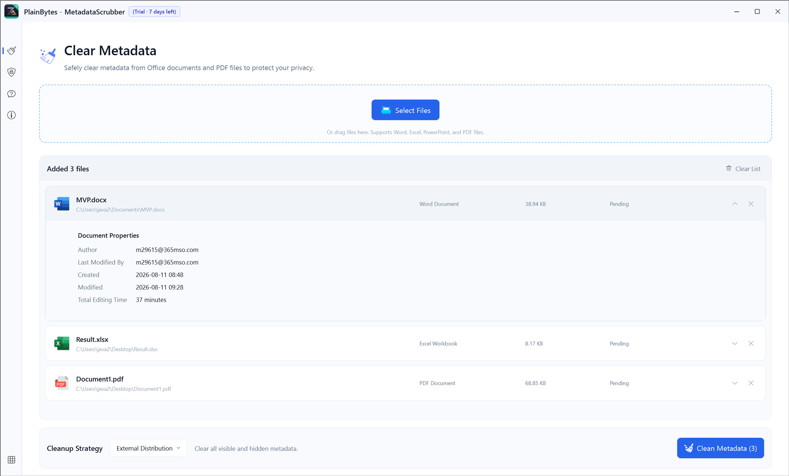

  

  # PlainBytes MetadataScrubber

  **Review and remove unwanted metadata from documents before sharing.**

PlainBytes MetadataScrubber is a Windows desktop application that helps you inspect supported document metadata and remove selected information before distributing files—individually or in batches.

Processing is performed locally on your Windows PC. Files are not uploaded to PlainBytes Studio for metadata cleaning.

## Features

- **Inspect metadata** — Review detected document properties before making changes.
- **Flexible cleaning strategies** — Use the default cleanup strategy or configure custom strategies in the app.
- **Batch processing** — Process multiple files, including a mixture of supported formats, and review individual results.
- **File Explorer integration** — Run the **default cleanup** from the File Explorer context menu (COM shell extension included in this repository under GPLv3).
- **Local processing** — Clean document metadata on your device without uploading the files for processing.

## Supported Formats

| Document type | Extension |
| --- | --- |
| Word documents | `.docx` |
| Spreadsheets | `.xlsx` |
| Presentations | `.pptx` |
| PDF documents | `.pdf` |

Available metadata fields and cleanup behavior vary by format and strategy.

## How It Works

1. **Add files** — Drag and drop or use the file picker to add one or more supported documents.
2. **Inspect and choose a strategy** — Review detected metadata if needed; use the default strategy or a custom one.
3. **Clear metadata** — Run cleanup and review per-file results before sharing.

You can also run the **default cleanup** from the Windows File Explorer context menu.

> **Important:** Cleaning may overwrite the original files. Back up important documents yourself before running a cleanup operation.

## Requirements

- Windows 10 or Windows 11, 64-bit
- Supported Office or PDF documents as listed above

**Limitations:** Metadata cleaning does not guarantee complete anonymization. Visible document content is not automatically anonymized. Some embedded, historical, or application-specific information may remain. Verify cleaned files before sharing, especially when handling sensitive documents.

## Download

You can install the official application from the Microsoft Store:

[**Download PlainBytes MetadataScrubber**](https://apps.microsoft.com/detail/9NPG7C2ZKHWS)

The Microsoft Store version offers a 7-day free trial, followed by a one-time purchase. The current U.S. price is $3.50 USD; pricing may vary by region.

Trial and purchase checks apply to the official Microsoft Store package.

## Open Source

PlainBytes MetadataScrubber is open-source software licensed under the **GNU General Public License v3.0 (GPLv3)**.

You can review the source code, build the application yourself, and redistribute or modify it under the terms of the license. Self-built unpackaged builds are not gated by the Store trial or in-app purchase check; you may also modify or remove that check under GPLv3.

Public Corresponding Source includes `PlainBytes.Core`, `PlainBytes.MetadataScrubber`, and `PlainBytes.MetadataScrubber.Shell`. Microsoft Store / MSIX packaging projects are not part of this public drop.

- [Source code](./)
- [License](./LICENSE)
- [Building from source](./BUILDING.md)
- [Changelog](./CHANGELOG.md)
- [Contributing](./CONTRIBUTING.md)
- [Trademarks](./TRADEMARKS.md)
- [Third-party notices](./THIRD_PARTY_NOTICES.md)

### Corresponding Source (Store builds)

For each official Microsoft Store release, we publish the corresponding source code in this repository under a version-specific Git tag.

- Git tags use the complete Store package version (for example, `1.0.4.0` → `v1.0.4.0`).
- Find the source corresponding to your installed version under [Releases](https://github.com/plainbytesstudio/PlainBytes.MetadataScrubber/releases) or the repository's tags.
- The corresponding source includes the materials required under GPLv3 to build and modify the application (including the Explorer COM shell sources).
- The default branch may contain newer changes and may not correspond to a particular Store release.

See [BUILDING.md](./BUILDING.md) for build instructions and [CHANGELOG.md](./CHANGELOG.md) for release history.

## Privacy

Metadata inspection and cleaning run locally on your Windows PC.

- Your documents are not uploaded to PlainBytes Studio for processing.
- Inspection and cleaning do not require an internet connection for the scrub workflow.
- Strategies and results stay on your device.

For more information, see the [Privacy Policy](https://plainbytes.studio/privacy.html).

## Feedback and Contributions

Found a bug or have an idea for an improvement?

Please open an issue to report a problem or discuss a feature request. Contributions are welcome — see [CONTRIBUTING.md](./CONTRIBUTING.md). All contributions are subject to the project's GPLv3 license.

## About PlainBytes Studio

PlainBytes Studio creates practical Windows utilities designed to make everyday work simpler.

[Website](https://plainbytes.studio) · [Microsoft Store](https://apps.microsoft.com/detail/9NPG7C2ZKHWS)

---

Copyright © 2026 PlainBytes Studio. Names and logos are trademarks of PlainBytes Studio — see [TRADEMARKS.md](./TRADEMARKS.md).
